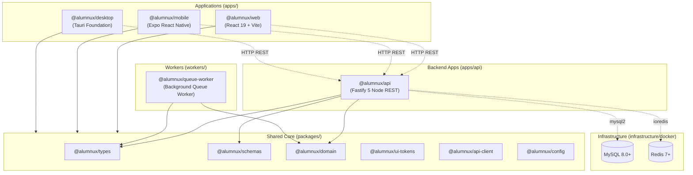

# ALUMNUX — Monorepo Architecture & Clean App Foundation

> **Platform Tagline:** Your Network. Your Next Chapter.  
> **Category:** Independent Student Career Guidance & Alumni Networking Platform  
> **Production Domain:** [https://mkcealumni.org](https://mkcealumni.org/)  
> **Monorepo Architecture:** pnpm Workspaces + Turborepo  
> **Backend Service:** Fastify 5 + TypeScript (Node.js)  
> **Target Database:** MySQL 8.0+ on cPanel Shared Hosting  
> **Client Applications:** Web (React 19 + Vite), Mobile (Expo React Native), Desktop (Tauri Foundation)

---
## 1. Project Overview & Governance

**Alumnux** is an independent career guidance and alumni networking ecosystem connecting ambitious students with industry-experienced alumni. The platform offers mentorship workflows, directory searches, job referrals, and structured institutional verification.

### Independent Governance Notice
Alumnux is independently maintained and governed by **three senior alumni trustees**. It is not an officially managed college platform, and institutional administration or faculty have no direct operational access or control over user verification.

---

## 2. Monorepo Architecture Summary

The repository is structured as a **pnpm monorepo** managed with **Turborepo** to ensure code reuse, contract consistency, and fast cached builds across all deployment targets:



---

## 3. Repository Directory Tree

```
Alumni/
├── apps/
│   ├── api/                     # Node.js Fastify REST API service with MySQL persistence
│   ├── web/                     # Full-featured responsive website (React, Tailwind CSS, Vite)
│   ├── mobile/                  # Expo React Native application for Android & iOS
│   └── desktop/                 # Lightweight Tauri desktop application foundation
├── docs/
│   ├── architecture/            # Monorepo architecture & request flow specs
│   ├── migration/               # Migration logs & verification data
│   ├── development/             # Comprehensive local development workflows
│   └── deployment/              # cPanel & container production deployment guide
├── infrastructure/
│   └── docker/                  # Docker Compose (MySQL, Redis, API) and Dockerfiles
├── packages/
│   ├── types/                   # @alumnux/types: Domain, user, verification, and API types
│   ├── schemas/                 # @alumnux/schemas: Shared Zod validation schemas
│   ├── domain/                  # @alumnux/domain: Pure business logic & lifecycle rules
│   ├── ui-tokens/               # @alumnux/ui-tokens: Cross-platform design tokens
│   ├── api-client/              # @alumnux/api-client: Typed HTTP client for all apps
│   └── config/                  # @alumnux/config: ESLint & TypeScript presets
├── scripts/
│   ├── clean.js                 # Cross-platform cache & artifact cleaning script
│   ├── start-desktop.cjs        # Native desktop launcher script
│   └── tauri-runner.cjs         # Cross-platform Tauri runner
├── workers/
│   └── queue-worker/            # Asynchronous background job worker
├── .env.example                 # Root environment template
├── .gitignore                   # Multi-workspace Git exclusion rules
├── package.json                 # Monorepo root manifest
├── pnpm-lock.yaml               # pnpm dependency lockfile
├── pnpm-workspace.yaml          # Workspace package mapping & build script approvals
├── tsconfig.base.json           # Shared base TypeScript configuration
├── turbo.json                   # Turborepo task pipeline configuration
└── README.md                    # Project documentation
```

---

## 4. Workspace Packages

| Package / App | Version | Status | Purpose |
| :--- | :---: | :---: | :--- |
| **`@alumnux/web`** | `1.0.0` | Active | Full-featured responsive website preserving all pages, components, and tests |
| **`@alumnux/mobile`** | `1.0.0` | Foundation | Expo React Native app with API health check and role picker |
| **`@alumnux/desktop`** | `1.0.0` | Placeholder | Tauri v2 desktop client foundation with API client binding |
| **`@alumnux/api`** | `1.0.0` | Active | Fastify REST API with `/health`, CORS, error handling, and request logging |
| **`@alumnux/types`** | `1.0.0` | Core | Shared domain interfaces (`UserRole`, `UserProfile`, `VerificationStatus`) |
| **`@alumnux/schemas`** | `1.0.0` | Core | Shared Zod schemas (Student/Alumni verification, Admin decision, Auth) |
| **`@alumnux/domain`** | `1.0.0` | Core | Business rules (Department catalog, verification lifecycle, grad year rules) |
| **`@alumnux/ui-tokens`** | `1.0.0` | Core | Design system tokens (colors, radii, spacing, typography, motion) |
| **`@alumnux/api-client`** | `1.0.0` | Core | Universal typed fetch client with configurable base URL and error models |
| **`@alumnux/config`** | `1.0.0` | Core | Reusable TypeScript compiler options and ESLint configurations |

---

## 5. Prerequisites & Getting Started

### Prerequisites
- **Node.js:** `v20.x`, `v22.x`, or `v24.x` (Tested with `v24.15.0`)
- **pnpm:** `v10.x` or `v11.x` (Tested with `11.21.0`)

### Installation
```bash
# 1. Clone the repository
git clone https://github.com/mkcealumnus/Alumni.git
cd Alumni

# 2. Checkout the migration branch
git checkout chore/monorepo-foundation

# 3. Install all workspace dependencies
pnpm install
```

### Environment Setup
Copy the environment template files:
```bash
# Windows PowerShell
Copy-Item .env.example .env
Copy-Item apps/web/.env.example apps/web/.env.local
Copy-Item apps/api/.env.example apps/api/.env
Copy-Item apps/mobile/.env.example apps/mobile/.env.local
```
```bash
# Unix / macOS
cp .env.example .env
cp apps/web/.env.example apps/web/.env.local
cp apps/api/.env.example apps/api/.env
cp apps/mobile/.env.example apps/mobile/.env.local
```

---

## 6. Development & Running Applications

### Run All Dev Tasks Concurrently
```bash
pnpm run dev
```

### Run Specific Workspaces
```bash
# Web application (http://localhost:3000)
pnpm run dev:web

# API Backend (http://localhost:4000)
pnpm run dev:api

# Mobile application (Expo Metro bundler)
pnpm run dev:mobile

# Desktop application (Tauri development)
pnpm run desktop:dev
```

---

## 7. Build, Test, Typecheck & Clean

Run repository-wide commands powered by Turborepo:

```bash
# Run typechecks across all workspaces
pnpm run typecheck

# Run unit tests across all applications and services
pnpm run test

# Run ESLint across codebases
pnpm run lint

# Build all packages, API, and web distribution bundle
pnpm run build

# Deep-clean all build artifacts and caches cross-platform
pnpm run clean
```

---

## 8. Current Limitations & Next Phases

### Current Status
- Monorepo restructuring complete with pnpm workspaces and Turborepo.
- The existing website is running from `apps/web` with all functionality preserved.
- Shared packages (`types`, `schemas`, `domain`, `ui-tokens`, `api-client`, `config`) are established.
- API foundation (`apps/api`) is operational with MySQL persistence, `/health` check, authentication endpoints, and unit tests.
- Mobile (`apps/mobile`) and desktop (`apps/desktop`) foundations established.
- Container infrastructure configured in `infrastructure/docker` (MySQL, Redis, API).
- Asynchronous queue worker foundation established in `workers/queue-worker`.

### Next Steps Roadmap
1. **Production MySQL Deployment:** Run database migrations against production MySQL using `apps/api/src/db/migrator.ts`.
2. **Verification Pipeline:** Implement secure document upload handling on cPanel for student and degree credentials.
3. **Mobile Screens:** Build out native student and alumni screens in `apps/mobile` consuming the shared API.
4. **Redesigned Web Application:** Launch the next-generation web frontend using the shared design tokens and API client.
