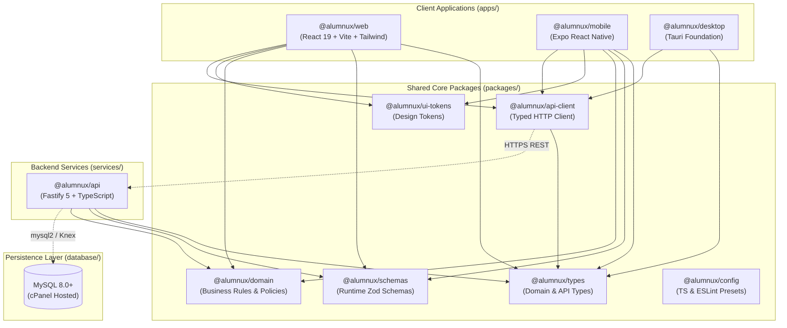

# Alumnux Monorepo Architecture

## 1. Executive Summary

**Alumnux** is an independent, non-institutional alumni and student career guidance platform designed for long-term scalability and cross-client consistency. The platform serves three distinct client applications (Web, Mobile, Desktop) backed by a unified HTTP API service and a production MySQL relational database hosted on cPanel shared hosting.

This document describes the architectural boundaries, package responsibilities, request flows, data access models, and guidelines for organizing features across the monorepo.

---

## 2. Monorepo Structural Boundaries

The monorepo is managed using **pnpm workspaces** and orchestrated by **Turborepo**. The architectural boundaries are strictly organized into four core functional zones:

---

## 3. Package & Application Responsibilities

### 3.1 Applications (`apps/`)

| Workspace | Technology | Responsibility |
| :--- | :--- | :--- |
| **`apps/web`** | React 19, Vite, Tailwind CSS, React Router 7 | The primary web portal for alumni and students. Hosts landing pages, registration, verification document upload, directory search, mentorship chats, and administrator verification queues. |
| **`apps/mobile`** | Expo (React Native), TypeScript | Mobile companion app for students and alumni on Android and iOS. Focuses on on-the-go notifications, mentorship messaging, and community updates. |
| **`apps/desktop`** | Tauri Foundation, TypeScript | Lightweight desktop client for trustees, institutional reviewers, and power users requiring native system tray notifications and multi-window workflows. |

### 3.2 Shared Packages (`packages/`)

| Package | Purpose & Boundary Rules |
| :--- | :--- |
| **`@alumnux/types`** | Single source of truth for TypeScript interfaces and type definitions (User, Role, Verification, Mentorship, API contracts, Pagination). **Must remain pure**: zero dependencies on React, React Native, DOM, or Node.js runtime APIs. |
| **`@alumnux/schemas`** | Shared runtime validation schemas powered by Zod. Validates form inputs on client-side and validates incoming request bodies on the API. |
| **`@alumnux/domain`** | Pure, framework-agnostic business rules (e.g., department catalogs, graduation year boundaries, verification lifecycle state machines, role authorization rules). |
| **`@alumnux/ui-tokens`** | Brand design tokens (palette, spacing, typography scales, radii, and motion curves). Usable across Web Tailwind CSS, React Native StyleSheets, and Desktop styling. |
| **`@alumnux/api-client`** | Universal typed HTTP client providing robust error handling, authorization headers, timeout aborts, and typed response promises across all three client apps. |
| **`@alumnux/config`** | Standardized linting (ESLint) and compilation configurations (TypeScript base, React, and Node presets). |

### 3.3 Services (`services/`)

| Service | Technology | Responsibility |
| :--- | :--- | :--- |
| **`services/api`** | Fastify 5, TypeScript, Node.js | Central REST API server. Handles request logging, CORS, security headers, authentication, health checks, verification processing, and data persistence. |

---

## 4. Request and Data Flow

1. **Client Action:** A student or alumnus triggers an action (e.g., submits verification documents via `apps/web` or `apps/mobile`).
2. **Client Validation:** Form inputs are validated against `@alumnux/schemas` before network transmission.
3. **HTTP Dispatch:** `@alumnux/api-client` packages the request, attaches the bearer token, and issues an HTTPS request to `services/api`.
4. **API Ingress:** `services/api` intercepts the request:
   - Validates CORS origin.
   - Logs request metadata (stripping passwords, authorization headers, and confidential tokens).
   - Validates request payload schema using `@alumnux/schemas`.
5. **Domain Processing:** Evaluates lifecycle rules using `@alumnux/domain` (e.g., confirming the transition from `PENDING` to `VERIFIED` is permissible).
6. **Persistence:** Executes parameterized queries against the cPanel MySQL database.
7. **Response Formatting:** Returns a standardized `ApiResponse<T>` with timestamp and error details if applicable.

---

## 5. MySQL & Persistence Architecture

The production database is MySQL 8.0+ hosted on cPanel shared hosting (`mkcealumni.org`).
- **Access Strategy:** In production, the API service runs on the same cPanel environment or connects via secure database credentials over localhost / unix socket / SSL.
- **Relational Integrity:** Foreign keys, unique constraints on user emails and department codes, and indexed status fields guarantee data integrity.
- **Isolation:** Frontend applications **never** access the database directly; all persistence occurs exclusively via `services/api`.

---

## 6. Guidelines for Organizing New Features

When introducing a new feature (e.g., "Job Referrals" or "Event Registration"):
1. **Define Types:** Add models in `packages/types/src/`.
2. **Define Schemas:** Add Zod validation in `packages/schemas/src/`.
3. **Define Business Rules:** Add pure logic (permissions, eligibility) in `packages/domain/src/`.
4. **Implement API Route:** Add the controller in `services/api/src/routes/` and corresponding unit tests.
5. **Update API Client:** Add client methods to `@alumnux/api-client`.
6. **Implement UI:** Consume the shared API client, schemas, and types in `apps/web` and `apps/mobile`.
