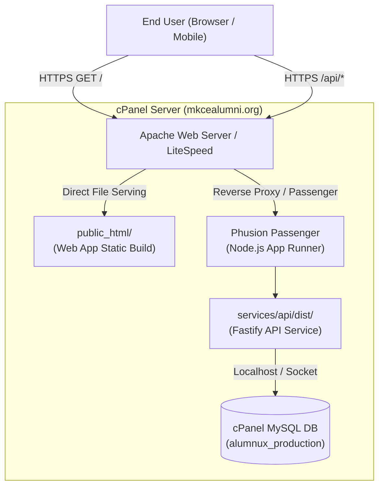

# cPanel Shared Hosting Deployment Guide

This document details the production deployment model for **Alumnux** on cPanel shared hosting (`https://mkcealumni.org`).

> [!NOTE]
> This guide defines the deployment architecture for Phase 2. No live deployment or modifications to `mkcealumni.org` or live production databases are performed during Phase 1.

---

## 1. Production Hosting Environment Constraints

- **Domain:** `https://mkcealumni.org`
- **Hosting Type:** cPanel Shared Hosting (CloudLinux / Apache)
- **Node.js Support:** cPanel "Setup Node.js App" (Phusion Passenger runner)
- **Database:** MySQL 8.0+ / MariaDB managed via phpMyAdmin
- **Access Level:** cPanel File Manager, phpMyAdmin, and SSH / Terminal

---

## 2. Deployment Architecture Model



---

## 3. Web Application Deployment (`apps/web`)

1. **Build Static Distribution:**
   From the local monorepo root:
   ```bash
   pnpm --filter @alumnux/web build
   ```
   This generates optimized static assets in `apps/web/dist/`.

2. **Upload to cPanel:**
   Upload the contents of `apps/web/dist/` into `public_html/`.

3. **SPA Routing Configuration (`.htaccess`):**
   Ensure an `.htaccess` file exists in `public_html/` to support React Router single-page navigation:
   ```apache
   <IfModule mod_rewrite.c>
     RewriteEngine On
     RewriteBase /
     RewriteRule ^index\.html$ - [L]
     RewriteCond %{REQUEST_FILENAME} !-f
     RewriteCond %{REQUEST_FILENAME} !-d
     RewriteCond %{REQUEST_URI} !^/api/
     RewriteRule . /index.html [L]
   </IfModule>
   ```

---

## 4. API Backend Deployment (`services/api`)

cPanel executes Node.js applications through the **Setup Node.js App** module (Phusion Passenger).

### 4.1 Standalone Artifact Generation
Shared hosting environments should not run the entire monorepo or compiler toolchains in production. Instead, a clean production deployment bundle is generated:
```bash
# 1. Build the API and all workspace dependencies
pnpm run build

# 2. Package services/api/dist along with package.json and production dependencies
```

### 4.2 cPanel Node.js Application Configuration
In cPanel > **Setup Node.js App**:
- **Node.js Version:** `20.x` or `22.x`
- **Application Mode:** `Production`
- **Application Root:** `alumnux_api` (outside `public_html`)
- **Application URL:** `api.mkcealumni.org` or `mkcealumni.org/api`
- **Application Startup File:** `dist/server.js`

### 4.3 Environment Variables
Configure environment variables securely inside the cPanel Node.js App UI (never commit real credentials to Git):
- `NODE_ENV`: `production`
- `PORT`: Assigned automatically by Passenger or specified port
- `CORS_ORIGIN`: `https://mkcealumni.org`
- `DB_HOST`: `localhost`
- `DB_NAME`: `mkcealum_alumnux`
- `DB_USER`: `mkcealum_user`
- `DB_PASSWORD`: `[SECURE_GENERATED_PASSWORD]`
- `JWT_SECRET`: `[STRONG_RANDOM_SECRET]`

---

## 5. MySQL Database Provisioning

1. **Create Database in cPanel:**
   - Navigate to **MySQL Databases** in cPanel.
   - Create database (e.g. `mkcealum_alumnux`).
   - Create user and assign all permissions (`SELECT`, `INSERT`, `UPDATE`, `DELETE`, `CREATE`, `ALTER`, `INDEX`).
2. **Import Initial Schema:**
   - Open **phpMyAdmin**.
   - Select the new database.
   - Import `database/schema/alumnux_mysql_schema.sql`.
   - Verify table generation: `departments`, `users`, `profiles`, `verification_requests`, `verification_evidence`, `mentorship_topics`, `mentorship_requests`, `audit_logs`.

---

## 6. Security & Operational Checklist

- [ ] **HTTPS Enforced:** Force SSL redirection in cPanel SSL/TLS Status (Let's Encrypt / AutoSSL).
- [ ] **Directory Browsing Disabled:** `Options -Indexes` in `.htaccess`.
- [ ] **Secret Isolation:** Database credentials and JWT secrets strictly managed via cPanel environment variables.
- [ ] **Health Monitoring:** Endpoint `https://mkcealumni.org/api/health` monitored via uptime checker (UptimeRobot).
- [ ] **Backup Automation:** Weekly cPanel MySQL dumps scheduled via Cron Jobs.
