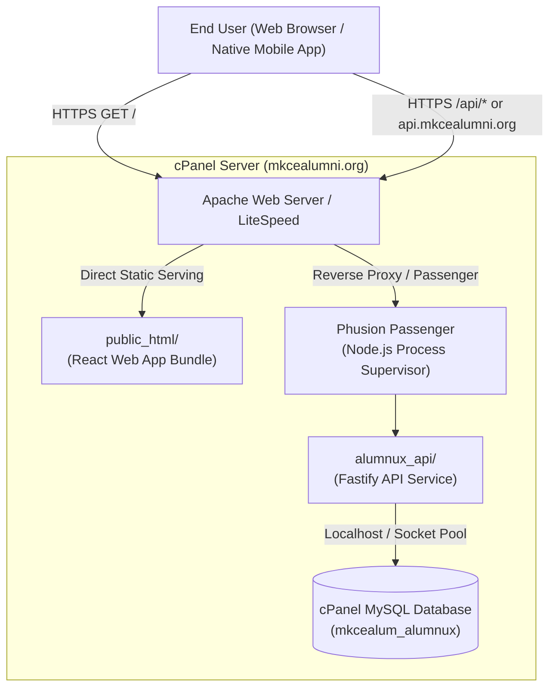

# cPanel Shared Hosting Deployment Guide — Phase 2 Production Runbook

This document details the production deployment, database provisioning, migration management, and application lifecycle for **Alumnux** on cPanel shared hosting (`https://mkcealumni.org`).

> [!IMPORTANT]
> Never commit real database passwords, JWT secrets, or production `.env` files into source control. All database credentials and secret keys must be supplied exclusively through cPanel environment variables or protected server configuration files.

---

## 1. Hosting Environment Specifications

- **Domain:** `https://mkcealumni.org`
- **Hosting Type:** cPanel Shared Hosting (CloudLinux / Apache / Phusion Passenger)
- **Node.js Engine:** Node.js `20.x` or `22.x` via cPanel **Setup Node.js App**
- **Database Engine:** MySQL 8.0+ / MariaDB 10.5+ managed via phpMyAdmin and MySQL Databases
- **Access Channels:** cPanel File Manager, phpMyAdmin, and SSH / Terminal

---

## 2. Architecture & File Hierarchy



### Directory Placement on Server:
- **Web App Static Root:** `/home/username/public_html/`
- **API Application Root:** `/home/username/alumnux_api/` *(Kept strictly outside `public_html` so source files and environment variables cannot be accessed via direct HTTP GET requests)*
- **API Startup Script:** `dist/server.js`

---

## 3. Database Provisioning & Versioned Migrations

### 3.1 Creating Database in cPanel
1. Navigate to **cPanel > MySQL Databases**.
2. Create database: `mkcealum_alumnux`.
3. Create user: `mkcealum_dbuser` with a strong 32+ character random password.
4. Add user to database with complete privileges (`ALL PRIVILEGES`: `SELECT`, `INSERT`, `UPDATE`, `DELETE`, `CREATE`, `ALTER`, `INDEX`, `DROP`, `REFERENCES`).

### 3.2 Running Database Migrations
Migrations are tracked through the `schema_migrations` table so they are repeatable, deterministic, and safe to execute:

#### Method A: Via SSH / Terminal (Recommended)
```bash
cd ~/alumnux_api
node dist/db/migrator.js
```

#### Method B: Via phpMyAdmin UI
If SSH access is restricted, import the SQL migration files sequentially in **phpMyAdmin**:
1. Open **phpMyAdmin** and select `mkcealum_alumnux`.
2. Import `database/migrations/003_create_auth_tables.sql` (Creates `users`, `profiles`, `auth_sessions`, and `schema_migrations`).
3. Import `database/migrations/004_create_mentorship_tables.sql` (Creates `mentorship_requests`).
4. Verify table integrity and foreign keys.

### 3.3 Core Database Tables (Phase 2)
| Table | Description | Key Indexes & Constraints |
| :--- | :--- | :--- |
| `users` | User credentials, roles, and status | `PRIMARY KEY (id)`, `UNIQUE (email)` |
| `profiles` | Extended academic and career profiles | `PRIMARY KEY (id)`, `UNIQUE (user_id)`, `INDEX (department)` |
| `auth_sessions` | Server-side refresh sessions & rotation hashes | `PRIMARY KEY (id)`, `INDEX (refresh_token_hash)`, `INDEX (user_id)` |
| `mentorship_requests` | 1-on-1 guidance requests and status transitions | `PRIMARY KEY (id)`, `INDEX (requester_id)`, `INDEX (recipient_id)` |
| `schema_migrations` | Versioned migration tracker | `PRIMARY KEY (version)` |

---

## 4. API Backend Configuration (`services/api`)

### 4.1 Required Production Environment Variables
Set these variables inside **cPanel > Setup Node.js App > Environment Variables**:

| Variable | Recommended Production Value | Description |
| :--- | :--- | :--- |
| `NODE_ENV` | `production` | Enables production optimizations and security rules |
| `PORT` | Auto-assigned by Passenger or `3001` | Listen port |
| `APP_ORIGIN` | `https://mkcealumni.org` | CORS allowed origin for credentialed requests |
| `DATABASE_HOST` | `127.0.0.1` or `localhost` | MySQL host provided by cPanel |
| `DATABASE_PORT` | `3306` | MySQL port |
| `DATABASE_NAME` | `mkcealum_alumnux` | cPanel database name |
| `DATABASE_USER` | `mkcealum_dbuser` | cPanel database user |
| `DATABASE_PASSWORD` | `[SECURE_DB_PASSWORD]` | Database password |
| `DATABASE_POOL_LIMIT` | `10` | Limit pool connections on shared hosting |
| `JWT_ACCESS_SECRET` | `[64_CHAR_RANDOM_SECRET]` | Cryptographic secret for signing short-lived access JWTs |
| `JWT_ACCESS_TTL` | `15m` | Access token lifespan |
| `REFRESH_TOKEN_TTL_DAYS` | `30` | Refresh token session expiration |
| `COOKIE_SECRET` | `[64_CHAR_RANDOM_SECRET]` | Cookie signing key for HttpOnly cookies |

### 4.2 Application Deployment Steps
1. Build the production package locally:
   ```bash
   pnpm run build
   ```
2. Upload `services/api/dist/` and `services/api/package.json` into `/home/username/alumnux_api/`.
3. In **Setup Node.js App**:
   - Set **Application Root**: `alumnux_api`
   - Set **Application Startup file**: `dist/server.js`
   - Click **Run NPM Install** (or install production dependencies).
   - Click **Restart Application**.

---

## 5. Web Frontend Deployment (`apps/web`)

1. Build static production distribution:
   ```bash
   pnpm --filter @alumnux/web build
   ```
2. Upload contents of `apps/web/dist/` into `/home/username/public_html/`.
3. Ensure `.htaccess` exists in `public_html/` with SPA fallback routing:
   ```apache
   <IfModule mod_rewrite.c>
     RewriteEngine On
     RewriteBase /
     RewriteRule ^index\.html$ - [L]
     RewriteCond %{REQUEST_FILENAME} !-f
     RewriteCond %{REQUEST_FILENAME} !-d
     RewriteCond %{REQUEST_URI} !^/api/
     RewriteRule . /index.html [L]
   </IfModule>
   ```

---

## 6. Restarting and Verifying the API

### Restarting the API Process:
```bash
# Touch passenger restart trigger
touch ~/alumnux_api/tmp/restart.txt
```
Or click the **Restart** button in cPanel **Setup Node.js App**.

### Health Check Verification:
Verify the live API health:
```bash
curl -i https://mkcealumni.org/api/health
```
Expected response:
```json
HTTP/2 200
content-type: application/json; charset=utf-8

{
  "status": "ok",
  "service": "alumnux-api",
  "version": "1.0.0",
  "database": "connected"
}
```

---

## 7. Safe Rollback Procedure

If any issue arises during cutover:
1. **API Rollback:** Restore previous `dist/` directory in `~/alumnux_api/` and run `touch ~/alumnux_api/tmp/restart.txt`.
2. **Web Rollback:** Restore previous `public_html/` backup.
3. **Database Rollback:** Database migrations in Phase 2 are strictly additive (`users`, `profiles`, `auth_sessions`, `mentorship_requests`), ensuring zero destructive changes to legacy tables.
